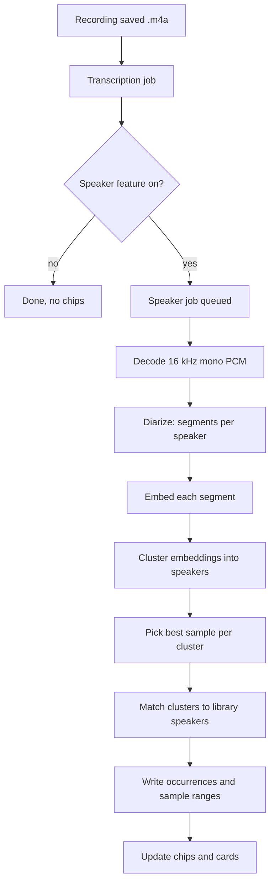

# Speaker Recognition

Status: Planning (draft v0.1)
Visual guide: [visual-guide.html](./visual-guide.html)
Owner: BorrowAI native team

---

## 1. Summary

Each memory is a voice note. Many notes contain more than one person (a conversation, a meeting, a call). Speaker recognition lets the user see who spoke in a memory and find a named person across memories.

The feature:

1. Detects every distinct speaker in a memory (diarization).
2. Shows speaker chips on each memory row in the list. A chip shows a recognized name or a neutral "Speaker N".
3. In the memory detail view, shows one card per speaker with a short voice sample from the original recording that the user can play.
4. Lets the user assign an unknown speaker to a named speaker already in the speaker library, or create a new named speaker.
5. Stores speakers and their samples locally so that older memories can be re-analyzed later to fill gaps.

Everything runs on-device. Audio never leaves the phone.

---

## 2. Goals and non-goals

### Goals

- Detect all speakers in a memory, not just "you vs. someone else".
- Show speaker chips on memory list rows without slowing scrolling.
- Play a sample from each speaker's own speech in the detail view.
- Assign an unknown speaker to a previously named speaker with one tap.
- Persist speakers, embeddings, and samples so the library grows over time.
- Let the user rename, merge, and delete speakers in a speaker library screen (v1, per Q-4).
- Re-analyze old memories in the background when the user opts in, the models change, or the user adds a speaker.
- Keep the existing recording, transcription, and categorization flows unchanged for users who never open the feature.

### Non-goals (v1)

- Cloud speaker identification or any server-side voice processing.
- Real-time speaker labels during recording. Analysis runs after the recording is saved.
- Speaker-attributed transcripts (who said which sentence). Chips and samples only in v1.
- Voice enrollment flows that ask the user to read a script.
- iOS speaker analysis in v1. iOS has no transcriber today, so the pipeline has no iOS input yet (see §10).

---

## 3. Terms

| Term | Meaning |
|---|---|
| Diarization | Splitting one audio file into time segments labelled by speaker ("who spoke when"). |
| Segmentation model | Model that finds speech turns and overlap in audio. |
| Embedding model | Model that turns a speech segment into a fixed-size vector (a voiceprint). |
| Cluster | Group of segments whose embeddings are close. One cluster is one speaker in one memory. |
| Speaker (library) | A person the user has named. Holds one or more embeddings and a display name. |
| Occurrence | One cluster in one memory. Links a memory to a speaker, either matched or unknown. |
| Sample | A short time range (default 4 to 8 s) from the original recording, chosen from the cluster's cleanest speech. |
| Match threshold | Cosine-similarity score above which an occurrence is auto-linked to a library speaker. |

---

## 4. User stories and acceptance criteria

### US-1: See who is in a memory

As a user, I want to see the speakers in a memory from the list so I know whether it was a solo note or a conversation.

- AC-1.1: Each memory row shows up to 3 speaker chips. Extra speakers show as "+N".
- AC-1.2: A chip shows the library name if the occurrence is matched, otherwise "Speaker N" (N is 1-based, ordered by first appearance in the audio).
- AC-1.3: Memories still being analyzed show a pending chip (no name, muted style), not an empty row.
- AC-1.4: Memories with no speech detected show no chips and no pending state.
- AC-1.5: Scrolling a 500-memory list does not drop frames on a mid-range Android device. Chips come from a single query per page, never a per-row lookup.

### US-2: Hear who a speaker is

As a user, I want to hear a short clip of each speaker in a memory so I can recognize them.

- AC-2.1: The detail view shows one speaker card per occurrence, ordered as in the chips.
- AC-2.2: Each card has a Play button that plays only that speaker's sample, from the original `.m4a`.
- AC-2.3: Only one sample plays at a time. Starting another stops the first.
- AC-2.4: If the original recording file is missing, the card shows "Audio unavailable" and no play button. Other data still shows.
- AC-2.5: A sample never spans a speaker change. It is taken from a single segment or a merged run of one speaker.

### US-3: Name an unknown speaker

As a user, I want to tell the app who an unknown speaker is so future memories and older memories show that name.

- AC-3.1: An unknown speaker card has an "Assign" action that opens a sheet listing library speakers, sorted by recent use, plus "New speaker".
- AC-3.2: Choosing a library speaker links this occurrence to that speaker and stores the occurrence's embedding on that speaker.
- AC-3.3: Choosing "New speaker" asks for a name, creates a library speaker, and links the occurrence to it.
- AC-3.4: After assigning, the chip and card update in the list and detail view without a restart.
- AC-3.5: Assigning does not change other memories automatically in v1. Those memories can be re-analyzed (US-5).

### US-4: Recognize a known speaker automatically

As a user, I want new memories to show my known speakers without me doing anything.

- AC-4.1: After analysis, each occurrence is compared with every library speaker's embeddings. If the best score is at or above the match threshold, the occurrence is linked automatically.
- AC-4.2: Occurrences below the threshold stay unknown ("Speaker N").
- AC-4.3: A user's manual assignment is never overridden by automatic matching.
- AC-4.4: Auto-links can be undone from the card ("Not this person"). That occurrence becomes unknown and is excluded from matching against that speaker.

### US-5: Re-analyze older memories

As a user, I want older memories to pick up speakers I added later.

- AC-5.1: Each memory stores the speaker-model version and matching-library version it was analyzed with.
- AC-5.2: When the user opts in, a speaker is created, or the speaker model changes, memories with an older version are queued for re-analysis. The queue is drained in the background, at low priority, on every app launch.
- AC-5.3: Re-analysis never removes manual assignments. It only fills unknown or auto-matched occurrences.
- AC-5.4: Re-analysis is enabled as soon as the user opts in (§9.8). There is no separate control to start or stop it. Turning the feature off stops it.

### US-6: Stay in control of privacy

As a user, I want to turn the feature off and know that nothing leaves the device.

- AC-6.1: Settings has a "Speaker recognition" toggle, off by default until the models are downloaded and the user opts in.
- AC-6.2: The Settings row explains: "Voice analysis runs on this device. Voice samples are stored only in this app."
- AC-6.3: Turning the feature off stops new analysis. Existing speakers stay until the user deletes them.
- AC-6.4: Deleting a memory deletes its occurrences and sample clips. Speaker embeddings from that memory are removed too.
- AC-6.5: The first time the user turns the feature on, a consent screen explains on-device analysis, what is stored, and how to withdraw (§9.8). No analysis runs until the user taps "Agree". Declining leaves the feature off.
- AC-6.6: The user can withdraw consent from Settings. This stops analysis and deletes all speaker data (speakers, embeddings, sample clips).

---

## 5. Flow

The speaker job runs after transcription, so the transcription status is never blocked by speaker analysis.

---

## 6. Data model

### 6.1 Memory changes

Add to `Memory` (`data/domain/Memory.kt`), following the existing status and attempt pattern:

| Field | Type | Default | Notes |
|---|---|---|---|
| `speakerStatus` | enum (`PENDING`, `ANALYZING`, `DONE`, `FAILED`, `SKIPPED`) | `PENDING` | `SKIPPED` when no speech or feature off. |
| `speakerAttempts` | Int | 0 | Capped, same as transcription. |
| `lastSpeakerError` | String? | null | Shown in debug only. |
| `speakerAnalysisVersion` | Int? | null | Set when analysis completes. |

### 6.2 New entities

Stored in a separate Couchbase Lite collection set, managed by `KotbaseSpeakerService`. The memory collection is not changed beyond §6.1.

**Speaker** (library)

| Field | Type | Notes |
|---|---|---|
| `id` | String (UUID) | |
| `name` | String | User-provided, unique case-insensitively. |
| `createdAt` | Instant | |
| `lastUsedAt` | Instant | Sort key for the assign sheet. |
| `embeddingCount` | Int | Capped at 10 by dropping the oldest embeddings. |

**SpeakerEmbedding**

| Field | Type | Notes |
|---|---|---|
| `id` | String | |
| `speakerId` | String? | Null while the embedding belongs to an unknown occurrence. |
| `vector` | FloatArray (blob) | Dimension set by the embedding model. Stored with the model version. |
| `modelVersion` | Int | Embeddings from different versions are never compared. |
| `sourceOccurrenceId` | String | |

**SpeakerOccurrence** (one cluster in one memory)

| Field | Type | Notes |
|---|---|---|
| `id` | String | |
| `memoryId` | String | Indexed. |
| `ordinal` | Int | 1-based "Speaker N" label. |
| `speakerId` | String? | Null when unknown. |
| `link` | enum (`NONE`, `AUTO`, `MANUAL`) | `MANUAL` is never overwritten by matching. |
| `rejectedSpeakerIds` | List<String> | Filled by "Not this person" (AC-4.4). |
| `totalSpeechMs` | Long | Used to rank samples and to drop tiny clusters. |
| `sampleStartMs` | Long | Relative to the recording. |
| `sampleEndMs` | Long | |
| `embeddingId` | String | Centroid embedding for this occurrence. |

**Rules**

- A memory deleted in `DeletedMemoryPurger` also deletes its occurrences, embeddings with `speakerId == null` tied to it, and no sample file is kept (samples are time ranges, not files, see §8.3).
- `recordingPath` stays relative. No absolute paths are stored.
- All reads and writes return Arrow `Either<MemoryError, T>` (add `SpeakerError` cases under `MemoryError` or a sibling type).

---

## 7. Pipeline and jobs

### 7.1 Runner

`SpeakerAnalysisRunner` follows `TranscriptionWorkRunner`:

- One drain loop, guarded by a lock, that processes one memory at a time.
- Attempt cap (3). After the cap, `speakerStatus = FAILED`.
- Skips work while a recording is active (same guard as `RecordingReconciler`).
- `shutdown()` is called before the database closes in `AppServices.close()`.
- Priority: new memories first, then re-analysis (AC-5.2).

### 7.2 Steps for one memory

1. Check the feature flag and the model state. If disabled or unavailable, set `SKIPPED` and stop.
2. Decode the `.m4a` to 16 kHz mono float PCM. Reuse the Android decode path from `AndroidBatchTranscriber`.
3. Run segmentation to get speech turns with speaker-local labels.
4. For each turn, compute an embedding with the embedding model.
5. Cluster embeddings (agglomerative, cosine distance, threshold in §9.3). Merge clusters that are too similar. Drop clusters under `minSpeechMs` (default 1500 ms) as noise.
6. Cap clusters at `maxSpeakersPerMemory` (default 8). Extra clusters merge into the nearest one.
7. For each cluster, pick the sample range: the longest single-speaker run of at least 4 s, clipped to 8 s. If none, use the longest run available.
8. Compute each cluster's centroid. Compare it with every library speaker's embeddings. Use the best score, and link `AUTO` if it is at or above the match threshold and the speaker is not rejected.
9. Write occurrences, the centroid embedding, and the sample range in one transaction. Set `speakerStatus = DONE` and `speakerAnalysisVersion`.
10. Emit a change event so the list and detail views refresh.

### 7.3 Re-analysis

- Queued by: opt-in (covers all existing memories), speaker created, speaker model upgraded.
- Drained by: app launch, in the background at low priority (AC-5.2).
- Re-analysis recomputes segmentation and clusters, then re-runs matching. It keeps `MANUAL` links where the occurrence's centroid still maps to the same speaker. Otherwise the manual link stays as it was (see AC-5.3). Simple rule for v1: a manual link is never removed by re-analysis.
- Runs with the same low priority as other background jobs. Pauses while recording.
- Launch gate (proposed, confirm in S-7): the drain starts only when the device is not recording, battery saver is off, and battery is at least 20% or charging. It stops if any of these change mid-run, and the remaining queue waits for the next launch.
- Scope in v1: the drain runs only while the app process is alive. No WorkManager or BGTask job in v1. The queue is persisted, so a killed app loses nothing.

---

## 8. Models and storage

### 8.1 Models

Add two roles to `ModelCatalog` (`data/service/model/ModelCatalog.kt`):

| Role | Candidate | Source | Notes |
|---|---|---|---|
| `SPEAKER_SEGMENTATION` | pyannote segmentation 3.0 (int8) | sherpa-onnx `speaker-segmentation-models` release | License must be checked before shipping (see §12). |
| `SPEAKER_EMBEDDING` | 3D-Speaker or NeMo speaker embedding | sherpa-onnx `speaker-recongition-models` release | Pick the smallest model that passes the spike (§11). |

Each entry pins URL, revision, SHA-256, and size, same as the existing models. Integrity checks stay in place.

### 8.2 Tiers

| RAM tier | Speaker models |
|---|---|
| LEGACY (<5 GiB) | Feature off by default. Available only if the spike shows RTF ≤ 0.5 on the reference low-end device. |
| MID (5–10 GiB) | Enabled. |
| LATEST (≥10 GiB) | Enabled. Same models for v1. |

### 8.3 Sample storage

Samples are stored as time ranges in the original `.m4a`, not as separate audio files. This keeps storage flat and avoids a second copy of audio. Playback seeks into the original file. If the file is missing, the card shows "Audio unavailable" (AC-2.4).

### 8.4 Storage cost

Estimate per memory: segment embeddings are not stored. Only centroid embeddings (one per occurrence, about 200 to 1000 floats) and occurrence rows. Expected size is a few KB per memory.

---

## 9. UI

### 9.1 Memory list row

- Speaker chips sit under the summary line, left-aligned, same height as the category chip.
- Chip states: recognized (filled with the speaker's colour, name), unknown (outline in the speaker's colour, "Speaker N"), pending (muted grey, no label, subtle pulse), overflow ("+N").
- Each speaker has a colour from the palette in §9.7. Colour is never the only cue: the state (filled or outline) and the label always carry the same meaning.
- Chips are tappable. Tapping a chip opens the detail view scrolled to that speaker's card.

### 9.2 Memory detail

- New "Speakers" section below the transcript, above the category.
- One card per occurrence, showing: label or name, speech duration, a Play button for the sample, and the action button.
- Action button is "Assign" for unknown, "Change" for matched, and "Not this person" as a secondary action on auto-matched cards.
- Empty state: "No speakers detected in this memory."

### 9.3 Assign sheet

- Bottom sheet with a search field, a list of library speakers (most recently used first), and a "New speaker" row at the bottom.
- Confirming returns to the detail view with the card updated.

### 9.4 Settings

- Row: "Speaker recognition" toggle, explanation line (AC-6.2). Turning it on shows the consent screen first (§9.8).
- Row: model status (downloaded, downloading, not available on this device).
- Row: "Withdraw consent and delete speaker data" (AC-6.6). Confirmed with a dialog.

### 9.8 Consent screen

- Shown once, before the first analysis, and again only if the user withdrew consent and turns the feature on again.
- Text: "BorrowAI can recognise who is speaking in your memories. Voice analysis runs only on this device. We store a voice fingerprint and short voice clips for each speaker, only in this app. Nothing is uploaded. You can turn this off or delete all speaker data at any time in Settings."
- Buttons: "Agree" (enables the feature and starts the queue) and "Not now" (feature stays off, nothing is stored).
- Consent is recorded with a timestamp and the consent text version, so a later text change can ask again.

### 9.5 Speaker library screen

- Reached from the “Speakers ›” link in the memory list header (to confirm). A Settings entry point is optional and not in v1 design.
- Lists every library speaker with name, number of memories, and last-seen date.
- Actions: rename, merge into another speaker, delete. Delete unlinks occurrences and does not delete memories.
- Merge moves all embeddings and links to the target and marks the source as deleted.

### 9.6 Thresholds (proposals, to be tuned in spike)

| Parameter | Proposed | Used for |
|---|---|---|
| Clustering distance | 0.5 cosine distance | Splitting speakers within a memory |
| Match threshold | 0.65 cosine similarity | Auto-linking to library speakers |
| Min speech per cluster | 1500 ms | Dropping noise clusters |
| Max speakers per memory | 8 | Capping clusters |
| Sample length | 4 to 8 s | Playback clip |

All values are proposals until measured in §11.

### 9.7 Speaker colours

- A fixed palette of 8 colours. Each colour is a fill colour that passes WCAG AA (4.5:1) with white text, plus a light tint for backgrounds.
- A library speaker keeps the same colour in every memory, chip, card, and sheet. The colour is stored with the speaker, not recomputed. (Confirmed.)
- An unknown speaker gets the first palette colour not used by another speaker in the same memory, in order of first speech. Colours can repeat across memories. (Confirmed.)
- Up to 8 speakers per memory (§9.6), so every speaker in one memory can have a distinct colour.
- Colour is decorative. State and label carry the meaning, so the palette works in greyscale. The palette is not checked for colour-blind separation yet. Spike S-8 should check it on real device screens.

---

## 10. Platform split

| Layer | Location | Contents |
|---|---|---|
| Domain and interfaces | `commonMain` | `Speaker`, `SpeakerOccurrence`, `SpeakerAnalyzer` interface, `SpeakerAnalysisRunner`, clustering and matching logic (pure Kotlin), `SpeakerService` interface |
| Persistence | `commonMain` | `KotbaseSpeakerService` (Couchbase Lite via Kotbase) |
| Analyzer, Android | `androidMain` | sherpa-onnx diarization and embedding wrapper, `UnavailableSpeakerAnalyzer` default |
| Analyzer, iOS | `iosMain` | `UnavailableSpeakerAnalyzer` only in v1. No iOS transcriber exists, so no input. |
| UI | `commonMain` | Chips, speaker cards, assign sheet, Settings rows |
| Playback | `androidMain` / `iosMain` | Seeked playback of a time range from the `.m4a` (reuse existing player) |

Clustering and matching are pure Kotlin in `commonMain` so they can be unit-tested on the JVM without a device.

---

## 11. Spike plan

Before any production code, run a spike on a branch. The spike answers these questions:

| # | Question | Method | Go / no-go |
|---|---|---|---|
| S-1 | Does the sherpa-onnx 1.13.8 Kotlin API expose offline diarization and embedding extraction? | Read the Kotlin API and build a minimal call | Go if both are callable from Kotlin. No-go means use a different runtime or a Kotlin-to-JNI wrapper. |
| S-2 | Real-time factor on the reference low-end Android device | Run diarization on 5 min of audio | RTF ≤ 0.5 and peak extra memory ≤ 250 MB. |
| S-3 | Same-speaker match quality | 10 memories, 3 speakers, label by hand | Same-speaker match ≥ 85% at the proposed threshold. |
| S-4 | Different-speaker false match | Same set, cross-speaker pairs | False match ≤ 5%. |
| S-5 | Model licenses | Read each model's license | Must allow shipping in a commercial app. |
| S-6 | Model size | Check download sizes | Combined download ≤ 60 MB. |
| S-7 | Launch-gate thresholds | Run a background drain on a low-end device and log battery drop, thermal state, and time to finish | Battery threshold (20%) and stop conditions hold, with no visible drain complaints. Tune if not. |
| S-8 | Speaker colour palette | Render the 8 colours on a real device in light and dark mode, and run a colour-blind simulation (protanopia, deuteranopia, tritanopia) on a memory with 4+ speakers | Every pair of speakers in one memory is distinguishable by name or state. If not, swap or drop colours. |

The spike writes its numbers into this file (§11 table, filled in) before implementation starts.

---

## 12. Open questions

These were open before implementation. All nine are decided, recorded in the Decision column below.

| # | Question | Decision |
|---|---|---|
| Q-1 | Maximum number of speakers per memory? | **8** (decided). |
| Q-2 | Overlapping speech: use the overlapped part as a sample? | **No.** Only single-speaker runs (decided). |
| Q-3 | Should manual matches be re-linked if a better speaker appears later? | **No.** Manual is final (decided). |
| Q-4 | Is a library management screen needed in v1? | **Yes.** Rename, merge, delete in v1 (decided). Changes §2 and §9.5. |
| Q-5 | iOS: hide chips or show them as unavailable? | **Hide** (decided). |
| Q-6 | When does re-analysis run? | **Background, low priority, on every app launch** (decided). Enabled as soon as the user opts in, with no separate control (AC-5.4). Queueing also happens on speaker creation and model upgrade (AC-5.2). |
| Q-7 | Is a consent screen needed, or is a Settings explanation enough? | **Explicit in-app consent** (decided, §9.8). Analysis does not start until the user agrees. Legal concerns (BIPA, GDPR Art. 9, CUBI) are treated as covered by this explicit opt-in and the delete-all path (AC-6.6). |
| Q-8 | Which speaker model license is acceptable? | **Any license that allows commercial use** (decided). S-5 still verifies each model. |
| Q-9 | Store speakers in a separate Couchbase collection (`KotbaseSpeakerService`) or in `KotbaseMemoryService`? | **Separate `KotbaseSpeakerService`** (decided). |

---

## 13. Privacy

- All processing is on-device. No network call is made for speaker analysis. The model download is the only network use, same as the existing models.
- Voice embeddings are biometric-like data. They are stored only in the app database, excluded from any export, and deleted with their memory or speaker.
- The feature is off by default. The user must agree on the consent screen (§9.8) before any analysis runs. Consent is recorded with a timestamp and text version, and can be withdrawn, which deletes all speaker data (AC-6.6).
- Logs never include embeddings, names, or sample times. Only counts and timings.
- Deleting all data (existing app reset) also clears the speaker collections.

---

## 14. Risks

| Risk | Impact | Mitigation |
|---|---|---|
| sherpa-onnx Kotlin API does not expose diarization | Blocks Android | Spike S-1 first. Fallback: JNI wrapper or different runtime. |
| Slow on low-end devices | Battery, heat, long queue | Tier gating (§8.2), low priority, pause during recording. |
| False matches confuse users | Wrong names shown | Conservative threshold, "Not this person" action, manual wins. |
| Model license blocks shipping | Feature cannot ship | Spike S-5 before any code. |
| Voiceprints collected without consent | Legal exposure (for example BIPA, GDPR Art. 9, CUBI) | Explicit consent screen before first analysis (§9.8, Q-7), with withdrawal that deletes all data (AC-6.6). |
| Overlapping speech gives bad samples | Poor playback | Single-speaker runs only (AC-2.5). |
| Re-analysis storms the battery | Poor UX | Launch gate in §7.3 (not recording, battery saver off, battery ≥ 20% or charging), batch size cap, low priority, the Settings toggle, which stops all analysis including re-analysis. |
| iOS feature gap | Inconsistent behavior | Hidden on iOS in v1 (Q-5). |
| Couchbase schema change | Data migration | Separate collections. Memory schema change is additive only. |

---

## 15. Phased rollout

| Phase | Scope | Exit criteria |
|---|---|---|
| P0 Spike | §11 spike on Android only | Go on S-1 to S-7. Numbers written to this file. |
| P1 Data and pipeline | Entities, `KotbaseSpeakerService`, clustering and matching in `commonMain`, runner, unit tests, no UI | Unit tests green. Analysis writes occurrences on a test memory. |
| P2 Read-only UI | Chips on list, speaker cards with sample playback, Settings toggle | US-1, US-2 acceptance criteria met on Android. |
| P3 Assignment | Assign sheet, speaker library screen (rename, merge, delete), auto-matching, "Not this person", manual links | US-3, US-4 met. Library screen works on Android. |
| P4 Re-analysis | Queue on opt-in, speaker creation and model upgrade; drain on app launch | US-5 met. |
| P5 iOS | Only after an iOS transcriber exists | Separate plan. |

Each phase is a separate MR with its own CHANGELOG entry and version bump (see `AGENTS.md`).

---

## 16. Test plan

### Unit (commonTest)

- Clustering: two synthetic speakers separate; one speaker stays one cluster; noise clusters dropped.
- Matching: score above threshold links; below does not; rejected speaker is skipped; manual link is never overwritten.
- Sample selection: never spans a speaker change; prefers the longest single-speaker run.
- Re-analysis: keeps manual links; only fills unknown or auto occurrences.
- Runner: attempt cap, skip while recording, `shutdown()` drains.

### Instrumented (androidInstrumentedTest)

- `KotbaseSpeakerServiceTest`: CRUD, cascade on memory delete, embedding cap.
- End-to-end: record a 60 s two-speaker clip, analyze, check two occurrences and playable samples.
- Missing audio file shows "Audio unavailable".

### Manual

- Two-person conversation, solo note, silent note, background noise.
- Assign, change, undo, re-analyze.
- Feature off mid-queue: jobs stop and no new rows appear.
- Low-end device run for RTF and battery.

### Fixtures

Use short public-domain or self-recorded clips. No real user audio in the repo.

---

## 17. Definition of done

- [ ] Spike numbers recorded in §11, and all go criteria met.
- [x] Open questions Q-1 to Q-9 answered and recorded here.
- [ ] Model licenses confirmed and pinned in `ModelCatalog`.
- [ ] Phase exit criteria in §15 met for each shipped phase.
- [ ] Unit and instrumented tests green in CI (`./gradlew :composeApp:testDebugUnitTest :composeApp:assembleDebug`).
- [ ] Consent screen text (§9.8) matches §13.
- [ ] Withdrawing consent deletes all speaker data (AC-6.6), tested on device.
- [ ] CHANGELOG entry and version bump in each MR.
- [ ] `visual-guide.html` matches the shipped UI, or the differences are noted.
